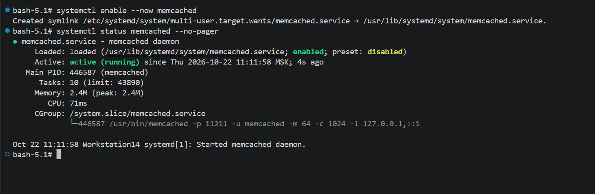
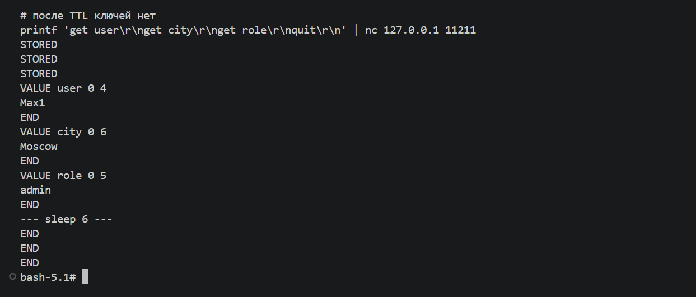
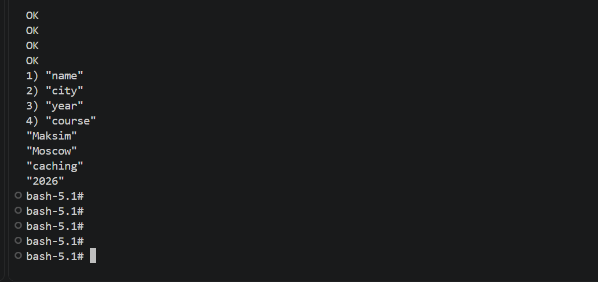

# Домашнее задание к занятию "Кеширование Redis/memcached" - Дорофеев Максим
Практическое задание с самопроверкой. Выполнено на Rocky Linux 9 (WSL).
---
### Задание 1. Кеширование
Примеры проблем, которые решает кеширование:
1. **Медленные ответы сайта/API** — частые одинаковые запросы не ходят каждый раз в тяжёлую БД, ответ берётся из быстрого кеша в памяти.
2. **Высокая нагрузка на СУБД** — часть чтения обслуживает Redis/Memcached, база меньше «задыхается» на пиках.
3. **Дорогие повторные вычисления** — результаты отчётов, агрегатов, рендера страниц можно сохранить на время и не пересчитывать заново.
4. **Лишняя нагрузка на внешние сервисы** — редко меняющиеся справочники и конфиги отдаются из кеша.
5. **Плохой UX при пиках** — кеш сглаживает всплески трафика, пользователи реже ждут долгий ответ.
---
### Задание 2. Memcached
Установлен и запущен `memcached` через systemd.

---
### Задание 3. Удаление по TTL в Memcached
Записаны ключи `user`, `city`, `role` с TTL = 5 секунд. Сразу после записи значения читаются; после ожидания 6 секунд ключи уже недоступны (`END`).

---
### Задание 4. Запись данных в Redis
В Redis записаны ключи `name`, `city`, `course`, `year`. Через `redis-cli` получены все ключи и значения.

